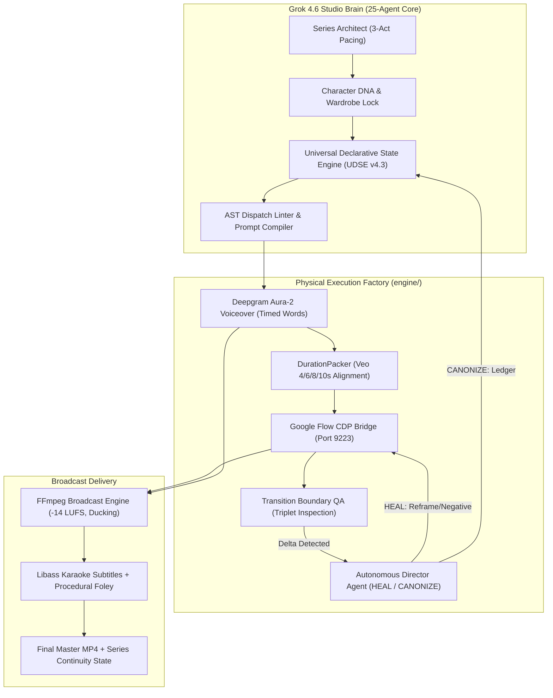

# 🎬 Hyper Maker Cinematic Studio (v4.3)
### Grok 4.6 Multi-Agent Brain × Google Flow CDP Factory × Deepgram Aura-2

[](LICENSE)
[](https://github.com/hyper-maker-app/youtube)
[](docs/plans/grok_v4_rearchitecture_plan.md)
[](https://x.ai)
[-red.svg)](chrome_flow.bat)
[](https://deepgram.com)

**Hyper Maker Cinematic Studio** is an autonomous AI-driven cinematic production studio and episodic YouTube series factory. It fuses high-level **xAI Grok 4.6 multi-agent narrative orchestration** with a physical **Google Flow CDP (Veo / Imagen 3)** rendering bridge, **Deepgram Aura-2** voiceover, and **FFmpeg broadcast post-production**.

---

## 🌟 Key Architecture & Capabilities



### 1. Universal Declarative State Engine (UDSE v4.3)
* **Entity-Attribute Binding (EAB):** Binds adjectives and material states strictly to discrete entity IDs, preventing diffusion models from misattributing attributes across objects.
* **Metric Spatial Partitioning:** Breaks coplanar ambiguity (e.g. separates door on Z=0 plane from window on left wall at 2.1m offset).
* **Contrastive Material Anchoring (CMA):** Anchors what an object IS by explicitly contrasting what it is NOT (e.g., solid 44mm quarter-sawn oak slab, zero glass, zero sidelights).
* **AST Dispatch Linter:** Statically scans prompts before submission; blocks any unpartitioned material co-occurrence at the code level.

### 2. Autonomous Director Agent (HEAL vs CANONIZE vs HYBRID)
* **4-Orthogonal-Axis Evaluation:** Inspects visual transitions across Ontology, Geometry/Axis (180° rule), Causal Continuity, and Narrative Utility.
* **Severity Taxonomy (`SEV0` to `SEV6`):**
  - **`SEV0`–`SEV1` (Cosmetic / Emergent Wear):** Triggers `CANONIZE` — crops a Token-Still, records into `WorldState.delta_ledger`, and injects only into downstream shots where that entity is visible.
  - **`SEV2` (Prop Shift):** Triggers `HYBRID` — freezes legal entities, repairs defective regions in tighter framing.
  - **`SEV3`–`SEV6` (Ontology / Axis Breach):** Triggers surgical `HEAL` — applies scoped negatives (`glass door, French door`), tightens camera perspective (`tighter_mcu`), and enforces a 2-attempt cap without uncontrolled downstream screenplay rewrites.

### 3. Google Flow CDP Physical Render Engine
* Direct Chromium remote debugging connection (**Port 9223**) with zero third-party cloud credit drain.
* Native resolution of discrete Veo duration tiers (`4.0s`, `6.0s`, `8.0s`, `10.0s`).
* Self-healing browser session lifecycle (`BrowserLease` with generation counters to eliminate zombie callbacks).
* Graceful capability degradation (`PROMPT_CANON` fallback when raw file-upload ingress is gated).

### 4. Broadcast Audio & Subtitle Master
* **Deepgram Aura-2 Timed Alignment:** Synchronizes discrete Veo video blocks to speech timelines using `DurationPacker` and frame-quantized timebases (`AUDIO_TB=1/48000`, `VIDEO_TB=1/24`).
* **Procedural SFX & Foley:** Dual-stage acoustic layer combining Hugging Face Spaces (`TangoFlux`, `AudioGen`) with procedural FFmpeg Lavfi synthesizers (whoosh, sub-bass thud, tension heartbeat, metallic impact).
* **Libass Karaoke Subtitles:** Dynamic color highlight per timed word with 100% English invariant.

---

## 🚀 Quick Start Guide

### 1. Prerequisites
- **Python 3.11+**
- **FFmpeg 7.0+** installed and added to `PATH`
- **Google Chrome** launched with remote debugging enabled on port 9223:
  ```powershell
  # Launch Chrome Flow Profile
  .\chrome_flow.bat
  ```

### 2. Environment Configuration
Copy `.env.example` to `engine/.env` and configure your API keys:
```bash
cp .env.example engine/.env
```
Ensure the following variables are set:
```ini
XAI_API_KEY=xai-...
XAI_MODEL=grok-4.6
DEEPGRAM_API_KEY=...
GEMINI_MODEL=gemini-3.5-flash-lite
PLAYWRIGHT_CDP_PORT=9223
```

### 3. Verifying the Engine
Check that Chrome CDP is reachable:
```powershell
curl.exe http://127.0.0.1:9223/json/version
```

### 4. Character DNA Setup
Initialize and lock your character DNA profile:
```powershell
python tools/cinematic_studio_cli.py dna init "The Barricaded Survivor" `
  --core "Survival horror protagonist barricaded in a hallway" `
  --clothing "Dark tactical utility jacket, leather gloves" `
  --anchor "forged steel pry-bar"

python tools/cinematic_studio_cli.py dna lock "The Barricaded Survivor"
```

### 5. Running Production

#### A. Pre-Production Planning (Zero Cost / No Render)
```powershell
python tools/cinematic_studio_cli.py produce-film "Project Rigor Mortis Episode 01" `
  --genre "Survival Horror" `
  --duration 74 `
  --plan-only
```

#### B. Dry-Run Offline Simulation (Test Assembly & Linter)
```powershell
python tools/cinematic_studio_cli.py produce-film "Project Rigor Mortis Episode 01" `
  --genre "Survival Horror" `
  --duration 74 `
  --dry-run
```

#### C. Full Live Physical Render (Veo + Deepgram + FFmpeg)
```powershell
python tools/cinematic_studio_cli.py produce-film "Project Rigor Mortis Episode 01" `
  --genre "Survival Horror" `
  --duration 74 `
  --voice-provider deepgram
```

#### D. Testing Visual Continuity QA Failure & HEAL Re-Roll Loop
```powershell
# Instant self-verifying test of Transition Boundary QA failure -> Director Agent HEAL -> Re-roll
python tools/cinematic_studio_cli.py test-continuity

# Or simulate defect on block 2 in full film production:
python tools/cinematic_studio_cli.py produce-film "Project Rigor Mortis Episode 01" `
  --duration 40 `
  --simulate-defect-block 2 `
  --dry-run
```

Output files will be generated under `out/<project-slug>/`:
- `final_film.mp4`: Final broadcast master video.
- `series_bible.json`: Structured 25-agent production bible.
- `captions.ass`: Libass styled karaoke subtitles.
- `continuity_state.json`: Sealed telemetry and WorldState snapshot for next episode continuation.

---

## 📁 Repository Structure

```
GROK_CINEMATIC_STUDIO/
├── characters/             # Character DNA profiles and Hero visual reference plates
├── config/                 # Engine presets, model matrices, and plugin packs
├── engine/                 # Physical execution factory
│   ├── providers/          # Flow CDP browser, Grok LLM, Deepgram TTS, FFmpeg SFX
│   ├── services/           # Series Architect, Director Agent, Prompt Compiler, Boundary QA
│   ├── editor.py           # FFmpeg broadcast master editor (-14 LUFS, sidechain ducking)
│   ├── captions.py         # Libass karaoke subtitle generator
│   └── flow_bridge.py      # End-to-end factory bridge
├── sequences/              # Generated handoff packets and scene specifications
├── tools/                  # CLI suite (produce_commands.py, dna_commands.py, models.py)
├── references/             # Architectural standards, ADR records, and production protocols
└── chrome_flow.bat         # Chrome CDP launcher for Google Flow on port 9223
```

---

## 📜 Architectural Decisions (ADR)
- **ADR-090 Zero-Hardcoding Mandate:** Strict separation of narrative logic from production code. Scene content is strictly schema-driven; no hardcoded story text inside engine code.
- **Protocol v4.0 Retention & Foley Standard:** 100% English invariant, 2nd-person POV ("You"), crisis hook within first 3 seconds, micro-survival mathematics.
- **UDSE v4.3 State Engine:** Deterministic EAB and contrastive material clauses preventing Veo diffusion bleed.

---

## 📄 License
This project is open-source under the [MIT License](LICENSE).
