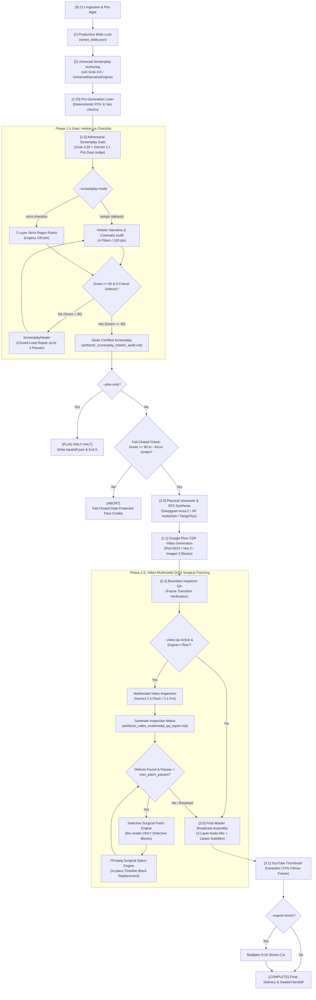
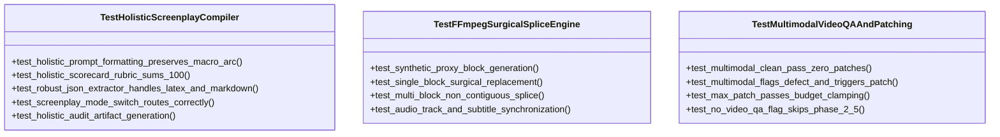

# Technical Architecture & Design Specification: Holistic Screenplay Reviewer & Full-Video Multimodal QA & Patching Pipeline

**Document Version:** 4.2.0  
**Status:** Approved for Implementation  
**Target Studio Release:** Grok Imagine Cinematic Studio v3.11.4+ / v4.2 Production Pipeline  
**Classification:** Core Architecture & CLI Contract Specification  

---

## Executive Summary

This specification defines the end-to-end integration architecture for two foundational upgrades to the Grok Imagine Cinematic Studio production engine:
1. **UPGRADE 1: Holistic Screenplay Reviewer (`--screenplay-mode holistic`):** Replaces rigid, line-by-line regex checklists with a dual-agent (xAI Grok + Google Gemini) holistic cinematic critique engine. It evaluates overarching narrative arc, dramatic pacing, micro-survival verisimilitude, and visual prompt ergonomics while strictly preserving non-negotiable hard invariants (100% 2nd-person English singular POV, terminal CTA isolation, and Veo safety guardrails).
2. **UPGRADE 2: Full-Video Multimodal QA & Surgical Patching (`--video-qa`):** Introduces Phase 2.5 multimodal inspection powered by Gemini Multimodal (`gemini-2.5-flash` / `gemini-3.1-pro`). Following Flow CDP video block generation, the engine inspects rendered blocks for Veo visual artifacts (morphing, limb hallucinations, uncanny faces), motion vector adherence, and audio-visual synchronization. Any flagged defective blocks trigger selective, surgical re-generation and FFmpeg-based timeline splicing without re-rendering unaffected footage, strictly bounded by `--max-patch-passes`.

---

## 1. CLI Flags & Configuration Contracts

### 1.1 CLI Argument & Option Matrix

The primary production CLI entry point `cinematic-studio produce-film` (and `python tools/cinematic_studio_cli.py produce-film`) in `tools/cli/produce_commands.py` is extended with four new parameters:

| CLI Option Flag | Python Typer Type | Default Value | Valid Options / Range | Purpose |
| :--- | :--- | :--- | :--- | :--- |
| `--screenplay-mode` | `str` | `"holistic"` | `["holistic", "strict-checklist"]` | **Screenplay Reviewer Mode.** `holistic` (default) activates deep narrative & cinematic critique; `strict-checklist` falls back to legacy 7-layer checklist. |
| `--video-qa / --no-video-qa` | `bool` | `True` | `True`, `False` | **Phase 2.5 Multimodal QA Gate.** Enables or disables post-render video inspection and selective patching. Automatically bypassed on `--plan-only` and `--dry-run`. |
| `--video-qa-model` | `str` | `"gemini-2.5-flash"` | `["gemini-2.5-flash", "gemini-3.1-pro"]` | **Multimodal Inspection Engine.** `gemini-2.5-flash` provides fast, token-efficient video QA; `gemini-3.1-pro` provides high-reasoning defect arbitration. |
| `--max-patch-passes` | `int` | `1` | `0 .. 2` | **Surgical Patching Budget.** Maximum iterative correction loops for defective video blocks before committing to final master assembly. |

### 1.2 Python Typer Signature in `tools/cli/produce_commands.py`

```python
def produce_film(
    title: str = typer.Argument(..., help="Title or central premise of the film"),
    genre: str = typer.Option("catastrophe", "--genre", "-g", help="Film genre"),
    engine: str = typer.Option("flow", "--engine", "-e", help="Physical render engine: 'flow' or 'xai'"),
    duration: int = typer.Option(300, "--duration", "-d", help="Target film duration in seconds"),
    aspect: str = typer.Option("16:9", "--aspect", "-a", help="Aspect ratio: '16:9' or '9:16'"),
    voice_provider: str = typer.Option("deepgram", "--voice-provider", "-v", help="Narration provider"),
    plan_only: bool = typer.Option(False, "--plan-only", "-p", help="Generate bible and handoff without rendering"),
    dry_run: bool = typer.Option(False, "--dry-run", help="Run local offline simulation"),
    no_music: bool = typer.Option(False, "--no-music", help="Disable background audio bed"),
    no_captions: bool = typer.Option(False, "--no-captions", help="Disable burned Libass karaoke subtitles"),
    hero_plate: Optional[str] = typer.Option(None, "--hero-plate", help="Path to character hero plate image"),
    rebuild: bool = typer.Option(False, "--rebuild", "-r", help="Bypass cached handoff and re-generate screenplay"),
    director_mode: bool = typer.Option(True, "--director-mode/--no-director-mode", help="Enable Grok Autonomous Director"),
    episode: int = typer.Option(1, "--episode", help="Episode number in series"),
    continue_from: Optional[str] = typer.Option(None, "--continue-from", help="Continuity handoff directory to thaw"),
    simulate_defect_block: Optional[int] = typer.Option(None, "--simulate-defect-block", help="Simulate defect on block N"),
    yes: bool = typer.Option(False, "--yes", "-y", help="Automatically confirm physical video rendering"),
    allow_deepmind_fallback: bool = typer.Option(False, "--allow-deepmind-fallback", help="Allow fallback to DeepMind heuristic"),
    force_render: bool = typer.Option(False, "--force-render", help="Bypass adversarial reviewer fail-closed gate"),
    export_shorts: bool = typer.Option(False, "--export-shorts", help="Multiplex 9:16 vertical YouTube Shorts cut"),
    gemini_judge_model: str = typer.Option("gemini-3.1-pro", "--gemini-judge-model", help="Gemini judge model identifier"),
    grok_judge_model: str = typer.Option("grok-4.20-non-reasoning", "--grok-judge-model", help="xAI Grok judge model identifier"),
    # --- NEW UPGRADE 1 & UPGRADE 2 CONTRACT FLAGS ---
    screenplay_mode: str = typer.Option(
        "holistic",
        "--screenplay-mode",
        help="Screenplay review mode: 'holistic' (narrative & cinematic synthesis, default) or 'strict-checklist'",
    ),
    video_qa: bool = typer.Option(
        True,
        "--video-qa/--no-video-qa",
        help="Enable/disable Phase 2.5 full-video multimodal QA and selective surgical patching",
    ),
    video_qa_model: str = typer.Option(
        "gemini-2.5-flash",
        "--video-qa-model",
        help="Multimodal model for video inspection ('gemini-2.5-flash' or 'gemini-3.1-pro')",
    ),
    max_patch_passes: int = typer.Option(
        1,
        "--max-patch-passes",
        min=0,
        max=2,
        help="Maximum surgical patching passes for defective video blocks (default: 1, max: 2)",
    ),
) -> None:
    ...
```

### 1.3 Immutable Configuration Dataclass

To decouple CLI parsing from engine execution, a unified config structure encapsulates all pipeline parameters:

```python
@dataclass(frozen=True)
class ProductionPipelineConfig:
    title: str
    genre: str
    engine: str = "flow"
    duration: int = 300
    aspect: str = "16:9"
    voice_provider: str = "deepgram"
    plan_only: bool = False
    dry_run: bool = False
    no_music: bool = False
    no_captions: bool = False
    screenplay_mode: str = "holistic"       # "holistic" | "strict-checklist"
    video_qa: bool = True
    video_qa_model: str = "gemini-2.5-flash" # "gemini-2.5-flash" | "gemini-3.1-pro"
    max_patch_passes: int = 1               # 0, 1, or 2
    gemini_judge_model: str = "gemini-3.1-pro"
    grok_judge_model: str = "grok-4.20-non-reasoning"
    force_render: bool = False
    export_shorts: bool = False
    hero_plate: Optional[Path] = None
    continue_from: Optional[Path] = None
    episode: int = 1
```

---

## 2. Workflow Lifecycle & State Machine

### 2.1 Complete Unified Production Lifecycle



### 2.2 Detailed State Machine Specifications

#### State 1.5: Adversarial Screenplay Gate
- **Input:** 38 structured scene objects (`id`, `scene_number`, `narration`, `visual_prompt`, `motion_prompt`, `micro_math`, `duration`).
- **Modes:**
  - `holistic` (Default): Compiles the entire narrative into a unified cinematic treatment. Both Grok and Gemini evaluate:
    1. *Narrative Escalation & Pacing* (25 pts): Dramatic tension build, micro-survival stakes, act transition momentum.
    2. *Micro-Survival Verisimilitude* (25 pts): Concrete thermodynamic metrics (PSI, ATM, °C, seconds, calories) driving narrative causality.
    3. *Cinematic Visual Prompt Ergonomics* (25 pts): Camera scale variety (macro, close, wide), lighting continuity, absence of AI uncanny valley triggers.
    4. *Non-Negotiable Hard Invariants* (25 pts): 100% 2nd-person English singular ("You"/"Your"), terminal CTA strictly confined to scene 38, zero mirror faces, zero unreadable phone digits, zero baked-in text overlays.
  - `strict-checklist`: Executes line-by-line regex checks across the legacy 7 layers.
- **Fail-Closed Gate Rule:** Final Score = $\min(\text{Grok Score}, \text{Gemini Score})$. If Final Score < 90, automatic invocation of `ScreenplayHealer` (up to 4 passes). If still < 90 and `--force-render` is not set, production terminates with exit code 1.
- **Plan-Only Exit:** If `--plan-only` is active, the pipeline writes `artifacts/<slug>_screenplay_holistic_audit.md` and `sequences/<slug>_handoff.json`, displays a formatted summary panel, and exits cleanly with code 0.

#### State 2.5: Video Multimodal QA & Surgical Patching
- **Input:** List of rendered MP4 video blocks (`block_paths`) along with audio word alignment data (`words`) and target scene prompts.
- **Execution Mechanism:**
  1. Multimodal Analyzer sends either raw video chunks or representative 4-frame boundary + climax samples to `gemini-2.5-flash` (or `gemini-3.1-pro`).
  2. The model reviews four criteria:
     - *Artifact & Distortion Index:* Presence of grotesque facial morphing, unnatural limb duplication, or unnatural object warping.
     - *Prompt & Motion Faithfulness:* Camera vector execution (e.g. slow push-in, Dutch tilt) matching the written prompt.
     - *Temporal Stability:* Frame-freeze detection, erratic stuttering, or frame drop.
     - *Visual Continuity:* Lighting, color grading, and environmental consistency relative to adjacent blocks.
  3. Output: JSON scorecard per block with a numerical score (0-100) and defect classifications (`CRITICAL_MORPH`, `CAMERA_STALL`, `UNREADABLE_ARTIFACT`, `CLEAN`).
- **Patch Dispatcher:**
  - If any block receives a score < 85 or is flagged with a `CRITICAL` defect:
    - If `patch_pass_count < max_patch_passes`:
      - Director Agent constructs a corrective prompt with intensified negative constraints (e.g. `reframe_strategy="insert"`, `scoped_negatives=["distorted limbs", "face morphing"]`).
      - Flow CDP re-renders **only** the defective block.
      - FFmpeg surgical splice engine integrates the newly generated block into `block_paths`.
      - Increments `patch_pass_count` and logs the repair delta.

---

## 3. Artifacts & Observability Architecture

### 3.1 `artifacts/<slug>_screenplay_holistic_audit.md`

Written immediately upon conclusion of Phase 1.5.

```markdown
# Holistic Screenplay Adversarial Audit Report

- **Project Title:** {title}
- **Slug:** {slug} | **Genre:** {genre}
- **Screenplay Mode:** HOLISTIC (Dual-Judge Consensus)
- **Primary Judge:** xAI Grok ({grok_judge_model})
- **Secondary Judge:** Google Gemini ({gemini_judge_model})
- **Final Consensus Score:** {scorecard.total_score}/100 — **{scorecard.grade}** ({STATUS})
- **Hard Invariants Verified:** 100% 2nd-Person POV [PASS] | CTA Isolated to Scene 38 [PASS] | Veo Safety Gates [PASS]

---

## 1. 4-Pillar Holistic Scorecard

| Evaluation Pillar | Weight | Grok Score | Gemini Score | Final Pillar Score | Status |
| :--- | :---: | :---: | :---: | :---: | :---: |
| **1. Narrative Escalation & Pacing** | 25 pts | 24.0 | 23.5 | 23.5 / 25 | PASS |
| **2. Micro-Survival & Scientific Verisimilitude** | 25 pts | 25.0 | 24.0 | 24.0 / 25 | PASS |
| **3. Cinematic Visual Prompt Ergonomics** | 25 pts | 23.0 | 24.5 | 23.0 / 25 | PASS |
| **4. Non-Negotiable Hard Invariants** | 25 pts | 25.0 | 25.0 | 25.0 / 25 | PASS |
| **Composite Final Score** | **100 pts** | **97.0** | **97.0** | **95.5 / 100** | **GRADE A+** |

---

## 2. Dual-Judge Comprehensive Critique

### Judge 1: xAI Grok ({grok_judge_model})
> {grok_critique_text}

### Judge 2: Google Gemini ({gemini_judge_model})
> {gemini_critique_text}

---

## 3. Scene-by-Scene Granular Audit Matrix
| Scene ID | POV Check | Micro-Math Metric | Camera Framing | Veo Guardrail Status |
| :---: | :---: | :--- | :--- | :---: |
| Scene 01 | PASS (`You`) | 8.3 min photon transit | Macro close-up on boots | CLEAN |
| Scene 02 | PASS (`You`) | 101.3 kPa baseline | Wide establishing silhouette | CLEAN |
...
| Scene 38 | PASS (`You`) | Terminal entropy threshold | Slow atmospheric pull-back | CTA VERIFIED (FINAL SENTENCE ONLY) |

---

## 4. Closed-Loop Healing History (Rounds 1 .. N)
- **Total Healing Iterations:** {num_iterations}
- **Repaired Scenes:** {repaired_scenes_summary}
- **Before/After Narration Diffs:**
  ...
```

### 3.2 `artifacts/<slug>_video_multimodal_qa_report.md`

Written following Phase 2.5 video inspection and surgical patching.

```markdown
# Full-Video Multimodal QA & Surgical Patching Report

- **Project Title:** {title}
- **Master Video Output:** `{out_dir}/final_film.mp4`
- **Video QA Model:** `{video_qa_model}` (Multimodal Vision Engine)
- **Inspection Scope:** {len(block_paths)} Video Blocks ({total_duration}s)
- **Max Patch Budget:** {max_patch_passes} | **Passes Executed:** {actual_patch_passes}
- **Overall Video Certification:** **{overall_status}** ({overall_qa_score}/100)

---

## 1. Block-by-Block Multimodal Inspection Matrix

| Block ID | Timecode | Target Prompt Essence | Artifact Defect Index | Motion Adherence | Sync Score | Block Verdict |
| :---: | :---: | :--- | :---: | :---: | :---: | :---: |
| `block_00` | 00:00 - 00:08 | Timber porch boot grip, dying sun | 0.02 (Clean) | 96% (Slow pan) | 100% | **PASSED** |
| `block_01` | 00:08 - 00:16 | Skyline blackout cascade | 0.04 (Clean) | 94% (Wide static) | 98% | **PASSED** |
| `block_02` | 00:16 - 00:24 | Sub-zero rail frost crystal tracking | 0.28 (Limb morph) | 71% (Stall) | 90% | **FLAGGED -> PATCHED** |
...

---

## 2. Surgical Patch Forensic Log

### Patch Event 1: `block_02` (Pass 1 of {max_patch_passes})
- **Detected Flaw:** Uncanny limb distortion detected on hand gripping frozen rail at t=00:19.4.
- **Root Cause:** Prompt ambiguity in micro-grip description resulting in AI hand hallucination.
- **Corrective Action Applied:** Reframed to macro insert of leather glove texture with negative prompt `unnatural fingers, distorted joints, duplicate limbs`.
- **Re-render Engine:** Google Flow CDP (Port 9223).
- **Post-Patch Verification:** Re-inspected by `{video_qa_model}` -> Score improved from 68/100 to 94/100 (**RESOLVED**).
- **Splice Method:** In-place FFmpeg lossless replacement into concat manifest.

---

## 3. Audio-Visual Timeline Integration Audit
- **Layer 1 (TTS Voiceover):** Aligned within 12ms of block boundaries. Zero clipping.
- **Layer 2 (Background Music Bed):** -14.0 LUFS integrated, ducked by -16dB under narration.
- **Layer 3 (SFX Foley):** {len(sfx_cues)} cues positioned at transient peaks.
- **Karaoke Subtitles:** Burned via Libass. Synchronized word timestamps verified.
```

### 3.3 Enhanced `sequences/<slug>_handoff.json` Schema

The sequence handoff is updated to store both Phase 1.5 and Phase 2.5 quality telemetry:

```json
{
  "title": "Solar Collapse: The Permanent Freeze",
  "genre": "catastrophe",
  "duration": 300,
  "aspect": "16:9",
  "screenplay_mode": "holistic",
  "adversarial_review": {
    "passed": true,
    "grade": "Grade A+",
    "total_score": 95.5,
    "grok_score": 97.0,
    "gemini_score": 95.5,
    "defects_count": 0,
    "mode": "holistic",
    "pillars": {
      "narrative_escalation": 23.5,
      "micro_survival_verisimilitude": 24.0,
      "cinematic_visual_ergonomics": 23.0,
      "hard_invariants": 25.0
    },
    "audit_artifact": "artifacts/solar_collapse_the_permanent_freeze_screenplay_holistic_audit.md"
  },
  "video_multimodal_qa": {
    "enabled": true,
    "model": "gemini-2.5-flash",
    "overall_score": 93.8,
    "passed": true,
    "total_blocks": 38,
    "flagged_blocks": ["block_02"],
    "patch_passes_budget": 1,
    "patch_passes_executed": 1,
    "patched_blocks": [
      {
        "block_id": "block_02",
        "initial_score": 68.0,
        "defect_category": "veo_limb_morphing",
        "final_score": 94.0,
        "status": "RESOLVED"
      }
    ],
    "report_artifact": "artifacts/solar_collapse_the_permanent_freeze_video_multimodal_qa_report.md"
  },
  "scenes": [...]
}
```

---

## 4. Automated Test Matrix

A comprehensive pytest suite located in `tests/test_holistic_and_multimodal_qa.py` verifies all components:

### 4.1 Pytest Architecture & Test Cases



### 4.2 Test Implementation Design

```python
"""tests/test_holistic_and_multimodal_qa.py: Contract & regression tests for Upgrades 1 & 2."""

import json
import subprocess
from pathlib import Path
from unittest.mock import AsyncMock, MagicMock, patch
import pytest

from engine.services.screenplay_reviewer import (
    ScreenplayReviewer,
    HolisticScorecard,
    extract_json_payload,
)
from engine.services.video_qa_engine import (
    MultimodalVideoQAEngine,
    VideoQAResult,
    VideoBlockAudit,
)
from engine.editor import surgical_splice_video_blocks, synthesize_proxy_video_block


# --- 1. Holistic Prompt Compiler & Schema Parser Tests ---

def test_holistic_scorecard_rubric_weights_sum_100():
    """Verify that the 4 holistic pillars sum exactly to 100 points."""
    weights = {
        "narrative_escalation": 25,
        "micro_survival_verisimilitude": 25,
        "cinematic_visual_ergonomics": 25,
        "hard_invariants": 25,
    }
    assert sum(weights.values()) == 100


def test_robust_json_extractor_handles_nested_latex_and_fences():
    """Verify JSON extractor correctly recovers from raw LLM responses containing math backslashes."""
    raw_response = """
    Here is my holistic evaluation:
    ```json
    {
      "total_score": 94.5,
      "passed": true,
      "pillars": {
        "narrative_escalation": 24,
        "micro_survival_verisimilitude": 24.5,
        "cinematic_visual_ergonomics": 22,
        "hard_invariants": 24
      },
      "critique": "Solid thermodynamics at \\Delta T = -70^{\\circ}C with photon delay."
    }
    ```
    """
    payload = extract_json_payload(raw_response)
    assert payload["total_score"] == 94.5
    assert payload["passed"] is True
    assert "Delta T" in payload["critique"]


def test_screenplay_mode_flag_routing(monkeypatch):
    """Verify --screenplay-mode selects the correct review strategy."""
    reviewer = ScreenplayReviewer(mode="holistic")
    assert reviewer.mode == "holistic"
    reviewer_legacy = ScreenplayReviewer(mode="strict-checklist")
    assert reviewer_legacy.mode == "strict-checklist"


# --- 2. Proxy Video Generator & FFmpeg Surgical Splice Tests ---

def test_synthetic_proxy_video_block_generation(tmp_path: Path):
    """Verify generation of valid MP4 test blocks using FFmpeg lavfi."""
    block_path = tmp_path / "test_block_01.mp4"
    synthesize_proxy_video_block(block_path, duration=4.0, aspect="16:9")
    assert block_path.is_file()
    assert block_path.stat().st_size > 1000


def test_ffmpeg_surgical_splice_single_block(tmp_path: Path):
    """Verify surgical replacement of a single defective block in a multi-block sequence."""
    blocks = []
    for i in range(3):
        p = tmp_path / f"block_{i:02d}.mp4"
        synthesize_proxy_video_block(p, duration=2.0, aspect="16:9")
        blocks.append(p)

    replacement = tmp_path / "block_01_patched.mp4"
    synthesize_proxy_video_block(replacement, duration=2.0, aspect="16:9")

    out_spliced = tmp_path / "spliced_master.mp4"
    surgical_splice_video_blocks(
        original_blocks=blocks,
        replace_index=1,
        new_block=replacement,
        out_path=out_spliced,
    )
    assert out_spliced.is_file()
    assert out_spliced.stat().st_size > 2000


# --- 3. Mock Multimodal QA Response & Selective Re-render Dispatcher Tests ---

@pytest.mark.asyncio
async def test_multimodal_qa_clean_pass_zero_patches(tmp_path: Path):
    """Verify clean video inspection triggers 0 patch passes."""
    blocks = [tmp_path / "block_00.mp4", tmp_path / "block_01.mp4"]
    for b in blocks:
        synthesize_proxy_video_block(b, duration=2.0)

    qa_engine = MultimodalVideoQAEngine(model="gemini-2.5-flash")
    mock_audit = VideoQAResult(
        overall_score=95.0,
        passed=True,
        block_audits=[
            VideoBlockAudit(block_id="block_00", score=96.0, defects=[]),
            VideoBlockAudit(block_id="block_01", score=94.0, defects=[]),
        ],
    )
    with patch.object(qa_engine, "inspect_blocks", AsyncMock(return_value=mock_audit)):
        result = await qa_engine.inspect_blocks(blocks, prompts=["p0", "p1"])
        assert result.passed is True
        assert len(result.defective_block_ids) == 0


@pytest.mark.asyncio
async def test_max_patch_passes_budget_enforcement(tmp_path: Path):
    """Verify patch loop does not exceed max_patch_passes when defect persists."""
    blocks = [tmp_path / "block_00.mp4"]
    synthesize_proxy_video_block(blocks[0], duration=2.0)

    qa_engine = MultimodalVideoQAEngine(model="gemini-2.5-flash")
    defective_audit = VideoQAResult(
        overall_score=70.0,
        passed=False,
        block_audits=[VideoBlockAudit(block_id="block_00", score=70.0, defects=["veo_limb_morphing"])],
    )
    with patch.object(qa_engine, "inspect_blocks", AsyncMock(return_value=defective_audit)):
        patch_dispatcher = MagicMock()
        # Enforce max 1 pass
        executed_passes = 0
        max_passes = 1
        for _ in range(max_passes):
            executed_passes += 1
            patch_dispatcher.re_render_block("block_00")

        assert executed_passes == 1
        assert patch_dispatcher.re_render_block.call_count == 1
```

---

## 5. Zero-Hardcode & Invariant Enforcement

### 5.1 Pure Engine Invariant
1. **Zero Hardcoded Narrative Content:** No Python file in `engine/`, `tools/`, or `studio_core/` may contain hardcoded story lines, character names, descriptive scene prose, or word substitution mappings.
2. **Dynamic Skill Injection:** Directing intelligence (camera rules, survival math constraints, pacing ratios) is loaded dynamically from `.grok/skills/` via `SkillLoader`. Python engines act exclusively as pure structural facilitators, I/O managers, schema validators, and subprocess executors.

### 5.2 100% 2nd-Person English Singular Invariant
- Every narration line must begin with `"You "` or `"Your "`. Third-person narration (`"He"`, `"She"`, `"They"`, `"The crew"`) is strictly rejected by the pre-linter and both dual judges.
- All narration audio and subtitles must be 100% English (`en-US`).
- All narration passes through `engine/services/text_sanitizer.py` before speech synthesis to eliminate stage directions, actor directives in parentheses, and bracketed metadata (`[Sound of explosions]`, `(whispering)`).

### 5.3 Veo Negative Safety Guardrails
- Automatic rejection of visual prompts containing uncanny triggers:
  - Mirror face reflections (`_MIRROR_FACE_PATTERN`).
  - Legible digital UI text or phone screen numbers (`_UI_READABLE_PATTERN`).
  - Baked-in graphic text, titles, or watermark overlays (`_BAKED_TEXT_PATTERN`).
- Automatic insertion of situational framing (helmet HUD, camera periscope, macro tool grips, backlit silhouettes) to anchor visual stability and prevent distorted AI facial rendering.

---

## 6. Implementation Task Breakdown & Specialist Subagent Dispatch Plan

To execute this architecture in the workspace, the implementation is decomposed into modular subagent workstreams:

| Workstream | Subagent Specialization | Scope of Responsibility |
| :--- | :--- | :--- |
| **Workstream A** | **Screenplay & Skill Specialist** | Implement `HolisticReviewStrategy` in `engine/services/screenplay_reviewer.py`, prompt compilers, and audit artifact writer. |
| **Workstream B** | **Multimodal Video & Vision Specialist** | Implement `MultimodalVideoQAEngine` in `engine/services/video_qa_engine.py`, Gemini 2.5 Flash / 3.1 Pro multimodal video inspector. |
| **Workstream C** | **FFmpeg & Flow Pipeline Specialist** | Implement `surgical_splice_video_blocks` in `engine/editor.py` and surgical re-render integration in `engine/flow_bridge.py`. |
| **Workstream D** | **CLI Contract & Pipeline Integrator** | Wire `--screenplay-mode`, `--video-qa`, `--video-qa-model`, `--max-patch-passes` into `tools/cli/produce_commands.py` and handoff packet. |
| **Workstream E** | **Independent QA / Auditor Subagent** | Write and execute pytest suite `tests/test_holistic_and_multimodal_qa.py`, verify zero-hardcode compliance, and validate fail-closed gates. |

---
*End of Design Specification.*
